<p align="center">
  
</p>

# Local SEO Brain

[](LICENSE)
[](CHANGELOG.md)
[](pyproject.toml)
[](assets/template-brain/wiki)
[](assets/template-brain/wiki/prompts)

**Get found by the people near you.**

Local SEO Brain is a plain-language guide and a working toolkit for showing up on Google Maps and Google Search when someone nearby needs a plumber, a roofer, a dentist, a cafe, or you. It is made for local business owners and for the agencies and consultants who serve them.

You give it what you already have: your Business Profile export, a reviews file, a list of directories, even notes. It writes a draft plan tied to that evidence. Nothing is posted or changed anywhere until you say yes.

> [!NOTE]
> Local SEO Brain is free and open source under the MIT license. Use it, change it, share it. If you want to dive deeper and work through it with us, join the [AI Marketing Hub Pro community](https://www.skool.com/ai-marketing-hub-pro).

## Why this matters

When someone searches for a service near them, Google usually shows a map with a short list of businesses first. The rest of the page comes after it. Google says it picks those results by three things: how well a business matches the search, how close it is to the person searching, and how well known it is. Google does not publish how much each one counts.

<p align="center">
  <picture>
    <source media="(prefers-color-scheme: dark)" srcset="assets/svg/map-pack-dark.svg">
    
  </picture>
</p>

Rankings also change street by street. A business that shows first from one side of town can be invisible from the other side. There is plenty of advice about all this online. What most owners are missing is a plan built from their own numbers, and the time to follow it.

## What you get

| | What it is | Why it helps |
| --- | --- | --- |
| **A plain guide** | 59 chapters on Business Profile, reviews, directories, your website and AI search, each marked with how well the advice is backed by evidence | You can read what matters and skip what does not |
| **37 ready-to-use prompts** | Questions you can hand to an AI assistant, written so it works from your data instead of guessing | Faster drafts without made-up facts |
| **Six current rulebooks** | Short notes on what Google officially says today about Search, Business Profile, structured data, AI search and community sites | You follow the real rules, not forum rumours |
| **A draft plan from your data** | A scorecard, a roadmap and a weekly report, built from your exports and marked **Draft** | You see what is missing before anyone touches your accounts |
| **An approval queue** | Every suggested change waits for your yes | Nothing goes live by accident |

Everything lives in an [Obsidian](https://obsidian.md) vault, which is a folder of plain text notes you own and can open anywhere.

## How it works

<p align="center">
  <picture>
    <source media="(prefers-color-scheme: dark)" srcset="assets/svg/how-it-works-dark.svg">
    
  </picture>
</p>

1. **Bring what you have.** A Business Profile export, a reviews file, a list of directories you are on, a geo-grid report if you have one. Notes are fine too.
2. **Get a draft plan.** The brain reads your files and writes a scorecard, a roadmap and a weekly report. Each line points back to the evidence it came from. Where there is no evidence, it says so instead of guessing.
3. **Approve what ships.** Every suggestion lands in an approval queue. You decide what goes out, and you or your agency post it. The brain never logs into your accounts.

## What it tells you

A few examples of the advice inside, all checked against Google's own published rules:

- **Use your real business name and the fewest accurate categories.** Keyword stuffing in the name is against Google's rules and can get a profile suspended.
- **If you work at customers' homes, hide your address and list a service area.** A mailbox, a coworking desk or a virtual office is not a business location.
- **Ask every customer for a review, reply to every review, never fake one.** Buying, swapping, filtering or gating reviews is prohibited. The brain drafts replies for you to approve. Reviewer names stay out of the notes.
- **Skip the made-up rules.** There is no official rule that says post twice a week or reply within 24 hours. The guide marks advice like that as unsupported.
- **AI answers use the same sources as search.** Google documents no secret file, special code or schema that gets you cited by AI features. Clear pages that answer real questions, plus a consistent name, phone and hours, are what you can control. Nobody can promise an AI will cite you.

## What it will never do

<p align="center">
  <picture>
    <source media="(prefers-color-scheme: dark)" srcset="assets/svg/never-dark.svg">
    
  </picture>
</p>

It refuses these even if you ask, because each one can get a profile suspended, a site penalised, or your trust broken. It also does not grade your business with a made-up score, and it does not claim to know why a competitor outranks you.

## Who it is for

| You are | What you use it for |
| --- | --- |
| **A tradesperson** (plumber, electrician, roofer, HVAC) | A clear list of what to fix on your profile and where your reviews stand |
| **A shop or clinic** (dentist, cafe, salon, vet) | Accurate details across every directory, and review replies you approve |
| **A builder or multi-location business** | One vault per location, same rules everywhere |
| **An agency or consultant** | Source-cited plans for each client, built from their exports, with nothing changed on a live account without the owner's yes |

## How to start

Start with what you already have: your Business Profile, your reviews and your website.

1. Download your Business Profile data from Google, export your reviews, and write down the directories you know you are listed on.
2. Follow the install steps in [For engineers and contributors](#for-engineers-and-contributors) below, or ask whoever runs your website to do it. It needs Python 3.11 or newer and nothing else.
3. Point the brain at your files. Read the draft scorecard. Approve the first fixes.

If you are not technical, the guide chapters and prompts are plain text and useful on their own.

## Licensing

Local SEO Brain is **open source under the [MIT license](LICENSE)**. You can use it for your own business or for clients, change it, and share it. Keep the copyright and license notice with any copy. It comes without warranty.

The MIT license covers the code, the guide chapters, the prompts, the evidence ledgers, and the project visuals. It does not cover the third-party historical course bundle that the first notes were generated from. That bundle is not in this repository and is not needed to use the brain. See [THIRD_PARTY_NOTICES.md](THIRD_PARTY_NOTICES.md) for the details and [PUBLISHING_NOTICE.md](PUBLISHING_NOTICE.md) for what stays private.

The repository is the full product. The [AI Marketing Hub Pro community](https://www.skool.com/ai-marketing-hub-pro) is where we go deeper on it together.

## Privacy

Your exports stay on your computer, in your vault. The brain does not send them anywhere and does not connect to Google, review sites or directories. Review-derived notes leave out the reviewer's name. A raw review export you load can still contain personal data, so keep the vault access-controlled.

## Support

See [SUPPORT.md](SUPPORT.md) for support channels, [SECURITY.md](SECURITY.md) for private vulnerability reporting, and [CONTRIBUTING.md](CONTRIBUTING.md) for repository rules.

## For engineers and contributors

<details>
<summary><strong>Architecture, install, evidence maintenance, deterministic demo and verification</strong> (click to expand)</summary>

### Overview

Local SEO Brain is an evidence-led, approval-first Obsidian operating brain for local SEO work. It combines generated notes from an operator-supplied historical seed with current doctrine, claim-level evidence, deterministic overlays, client-export adapters, and a read-only operator workflow.

Buyer: local SEO consultants, in-house operators, and agency teams who need source-cited decisions from authorized client exports without giving an automation control of live accounts.

This is open source software under the MIT [LICENSE](LICENSE). [THIRD_PARTY_NOTICES.md](THIRD_PARTY_NOTICES.md) lists material with separate rights, and [PUBLISHING_NOTICE.md](PUBLISHING_NOTICE.md) lists what must stay private.

### What ships

- 59 generated chapter notes and 37 reusable prompt notes, each carrying an explicit evidence disposition.
- Six current doctrine notes for Search, Business Profile, structured data, AI search, community participation, and provider-neutral model evaluation.
- Canonical source and claim ledgers with stable IDs, dates, locators, confidence, risk, contradictions, and refresh deadlines.
- Deterministic projections into the Obsidian vault and a cited research pack.
- Standard-library adapters for manual evidence, GBP CSV, citation CSV, review JSON/CSV, and geo-grid CSV exports.
- Draft deliverables, an Approval Queue, operator workflows, and strict safety boundaries.

The historical seed is a third-party course bundle supplied by the operator. It is not shipped in this repository and is not current authority. The 96 generated notes are committed, so nothing needs it at runtime. `references/historical-seed-outline.json` records the note IDs and the seed hash without any seed text, and an operator who holds the bundle can place it under `assets/template-brain/.raw/source-material/` to regenerate. Working notes use concise replacement content from `data/knowledge-overlays.json` for current corrections.

### Behavior and boundaries

Local SEO Brain is advisory. It does not edit Business Profile, Search Console, GA4, Maps, Places, review platforms, citation directories, websites, or any other external account.

The adapters preserve authorized raw exports in an immutable, content-addressed `.raw/` path and write descriptive notes. They do not infer ranking causes. Review-derived notes omit reviewer identity, but an operator-supplied raw review export can contain personal data and must remain in an access-controlled client vault.

`synthesize_brain.py` produces a **Draft** evidence-state scorecard, roadmap, and weekly report. It does not fabricate a grade, score, prioritization formula, or causal recommendation. See [Product Boundaries](docs/PRODUCT_BOUNDARIES.md).

Refusals include address or proximity gaming, virtual-office abuse, fake or gated reviews, PBN/link spam, hidden-text or doorway tactics, mass low-quality citation submission, prohibited Places storage, credentials in the vault, and guaranteed-ranking language.

### Install and quick start

Requirements: Python 3.11 or newer, no third-party Python dependencies.

```bash
git clone https://github.com/AI-Marketing-Hub/local-seo-brain.git
cd local-seo-brain

python3 scripts/scaffold_vault.py \
  --client acme-plumbing \
  --owner "Fixture Owner" \
  --out-dir /absolute/path/to/client-vaults \
  --as-of 2026-10-15
```

Every mutating command requires an explicit target and pinned date. Example ingestion:

```bash
VAULT=/absolute/path/to/client-vaults/acme-plumbing

python3 scripts/ingest_gbp.py \
  --vault "$VAULT" --client acme-plumbing \
  --file /absolute/path/to/gbp.csv --as-of 2026-10-15

python3 scripts/ingest_citations.py \
  --vault "$VAULT" --client acme-plumbing \
  --file /absolute/path/to/citations.csv --as-of 2026-10-15

python3 scripts/ingest_reviews.py \
  --vault "$VAULT" --client acme-plumbing \
  --file /absolute/path/to/reviews.json --as-of 2026-10-15

python3 scripts/ingest_geogrid.py \
  --vault "$VAULT" --client acme-plumbing \
  --file /absolute/path/to/geogrid.csv --as-of 2026-10-15

python3 scripts/synthesize_brain.py --vault "$VAULT" --as-of 2026-10-15
python3 scripts/lint_vault.py --vault "$VAULT"
python3 scripts/render_brain_report.py --vault "$VAULT"
```

Use `--dry-run` before a maintenance operation. Repository-target builds are refused unless the reviewed maintainer-only override is supplied.

### Evidence maintenance

The source of truth is:

- `references/source-ledger.json`
- `references/claim-ledger.json`
- `data/knowledge-overlays.json`

Validate the pinned snapshot and check its age independently:

```bash
python3 scripts/evidence_contract.py validate --as-of 2026-10-15
python3 scripts/evidence_contract.py freshness --as-of YYYY-MM-DD --format json
python3 scripts/evidence_contract.py check \
  --as-of 2026-10-15 \
  --vault assets/template-brain
```

Regenerate seeded notes only through the deterministic generator:

```bash
python3 scripts/ingest_knowledge_base.py \
  --vault /absolute/path/to/client-vault \
  --as-of 2026-10-15 \
  --dry-run
```

Canonical template-vault changes use reviewed, hash-bound Claude Obsidian transactions. Generated notes are corrected in the overlay, not by durable one-off patches.

### Deterministic demo

The checked-in sample is generated only from the template and repository fixtures:

```bash
python3 scripts/build_demo_vault.py \
  --out /tmp/local-seo-brain-demo/sample-vault \
  --as-of 2026-10-15
```

The sample receipt in `examples/sample-vault.sha256` is checked against a clean regeneration by `tests/test_demo_determinism.py`.

### Verification

The [October 15 verification report](docs/VERIFICATION_REPORT_2026-10-15.md) records this maintenance pass, including the failing Brainstein release gate. Run the complete gate from [RELEASE_CHECKLIST.md](RELEASE_CHECKLIST.md). The minimum standalone tests are:

```bash
python3 tests/test_pipeline.py
python3 tests/test_domain_ingestors.py
python3 tests/test_reseed_preserves_overlays.py
python3 tests/test_citation_contract.py
python3 tests/test_demo_determinism.py
python3 tests/test_cli_safety.py
python3 tests/test_privacy_and_refusals.py
python3 tests/test_version_consistency.py
python3 tests/test_documentation_claims.py
```

See the [vault organization review](docs/VAULT_QUALITY_2026-10-15.md) for note placement, link coverage, editorial corrections, and archive boundaries.

The current checkout reaches review-candidate maturity only when every repository, evidence, deterministic-build, privacy, Obsidian, and Brainstein gate passes. A version number alone does not establish market readiness.

### README visuals

The light and dark SVG pairs under `assets/svg/` are original static drawings with no scripts, external images or fonts. Provenance is recorded in [assets/NOTICE.md](assets/NOTICE.md).

</details>
